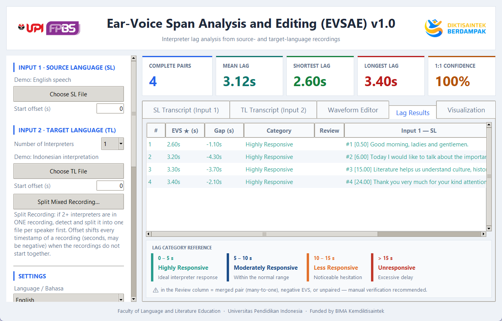
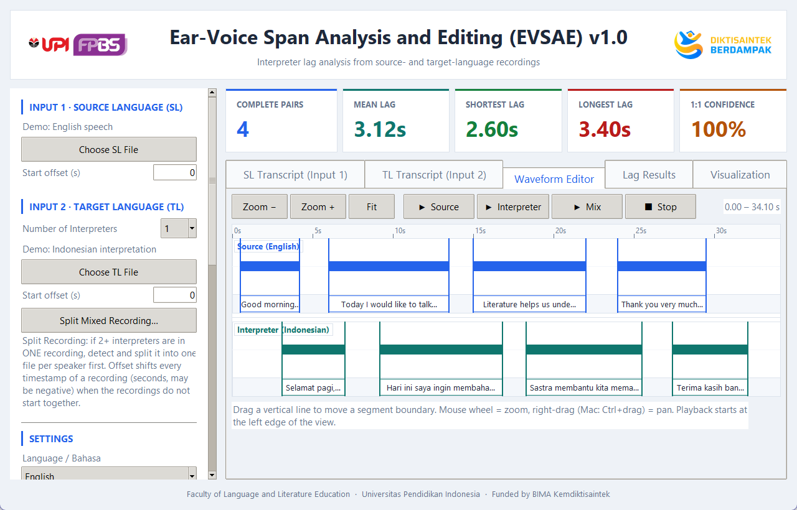
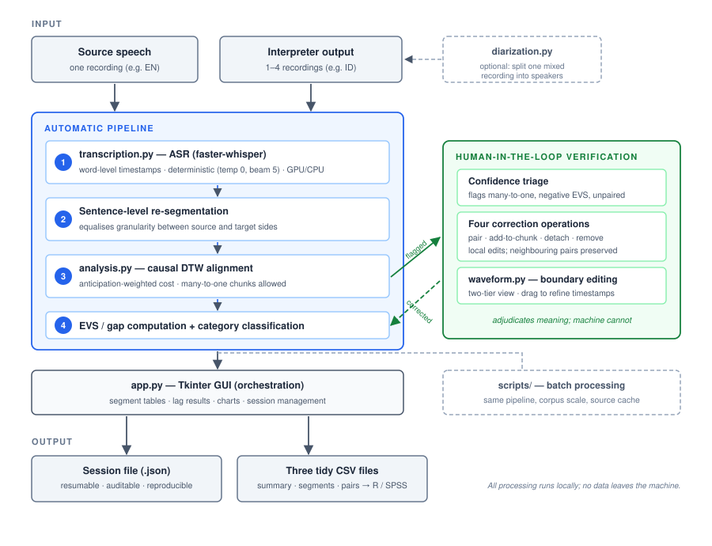

# EVSAE — Ear-Voice Span Analysis and Editing

**Automated Ear-Voice Span measurement with human-in-the-loop verification for
interpreting research.**

EVSAE is an open-source desktop application that measures the **Ear-Voice Span
(EVS)**, the delay between the onset of a source-language utterance and the
onset of the interpreter's corresponding rendition, from two separate
recordings: the original speaker and the interpreter. It automates the whole
pipeline that is normally done by hand in tools such as ELAN:

1. deterministic speech recognition with word-level timestamps
   ([faster-whisper](https://github.com/SYSTRAN/faster-whisper));
2. sentence-level re-segmentation so both sides have comparable granularity;
3. source–target alignment with a **causal dynamic time warping (DTW)**
   that never lets the interpreter "start before" the speaker beyond a small
   anticipation tolerance;
4. EVS / gap computation and lag categorisation;
5. a verification interface that flags only the doubtful alignments
   (confidence-based triage), so researchers check a subset instead of
   annotating everything.



---

## Contents

- [Features](#features)
- [Installation](#installation)
  - [Option A — Windows portable build (no Python needed)](#option-a--windows-portable-build-no-python-needed)
  - [Option B — From source (Windows, macOS, Linux)](#option-b--from-source-windows-macos-linux)
- [Quick start](#quick-start)
- [Workflow](#workflow)
- [Output files](#output-files)
- [Method](#method)
- [Repository structure](#repository-structure)
- [Building the distributables](#building-the-distributables)
- [Documentation](#documentation)
- [Citing EVSAE](#citing-evsae)
- [Licence](#licence)
- [Support and contributing](#support-and-contributing)
- [Acknowledgements](#acknowledgements)

## Features

- **Two independent inputs**: one source-language recording (Input 1, e.g.
  English) and one or more interpreter recordings (Input 2, e.g. Indonesian,
  up to four interpreters sharing the same timeline).
- **Any common audio/video format** (wav, mp3, m4a, mp4, webm, …). Audio is
  decoded with PyAV, so FFmpeg does not need to be installed separately.
- **Deterministic transcription** (temperature 0, VAD filtering): the same
  file always produces the same transcript and the same numbers.
- **GPU optional**: an NVIDIA GPU is used automatically when CUDA libraries are
  available; otherwise transcription runs on the CPU.
- **Causal DTW alignment** that handles different segment counts on each side
  (merges, splits, omissions) without accumulating drift.
- **Confidence triage**: a *1:1 confidence* score and a *Review* flag (⚠) on
  merged pairs, negative EVS and unpaired utterances.
- **Manual correction tools**: pair, add to pair, detach, delete, re-align.
- **ELAN-like two-tier waveform editor**: drag segment boundaries, zoom, pan,
  and play source / interpreter / mixed audio.
- **Start offsets** for recordings that did not start simultaneously, and a
  **speaker-split tool** for one recording that contains several interpreters.
- **Simultaneous and consecutive modes** (EVS or gap as the primary measure).
- **Session files** (JSON) that store transcripts, every manual correction and
  the settings, so verification is auditable and resumable.
- **CSV export** with English column names for Excel, SPSS or R.
- **Bilingual interface**: English and Bahasa Indonesia.

## Installation

### Option A — Windows portable build (no Python needed)

1. Download `EVSAE-portable (Windows).zip` from the
   [Releases](../../releases) page.
2. Extract the whole archive to a folder (do not run it from inside the zip).
3. Double-click `EVSAE.exe`.

The `small` Whisper model is bundled. Other models are downloaded once into
the `models` folder the first time they are selected. The portable build runs
on the CPU; use the source installation to benefit from an NVIDIA GPU.

### Option B — From source (Windows, macOS, Linux)

Requirements: **Python 3.10 or newer** (3.12 recommended) with Tkinter 8.6.

```bash
git clone https://github.com/diks15/evsae.git
cd evsae
python -m venv .venv
# Windows:        .venv\Scripts\activate
# macOS / Linux:  source .venv/bin/activate
pip install -r requirements.txt
python interpreter_lag_gui.py
```

**macOS.** Install Python from <https://www.python.org/downloads/macos/> (the
official installer ships Tk 8.6; avoid Apple's `/usr/bin/python3`). With
Homebrew Python, also run `brew install python-tk`. Instead of the commands
above you can double-click `EVSAE_macOS.command`: the first run creates a
virtual environment and installs the dependencies, later runs open the
application directly. If macOS blocks the file, right-click it → **Open** →
**Open** (needed once). Transcription on a Mac always runs on the CPU; Apple
Silicon handles the `medium` model comfortably.

**Linux.** Install Tk and PortAudio from your distribution, e.g.
`sudo apt install python3-tk libportaudio2` on Debian/Ubuntu.

**GPU (optional, Windows/Linux).** Install the CUDA 12 runtime libraries
required by CTranslate2, for example
`pip install nvidia-cublas-cu12 nvidia-cudnn-cu12==9.*`. EVSAE registers them
automatically on Windows and falls back to the CPU if they cannot be loaded.

## Quick start

1. Start EVSAE and click **Load Demo**. A short synthetic English speech and
   its Indonesian interpretation are loaded, so every tab can be explored
   without your own data.
2. Look at **Lag Results**, **Waveform Editor** and **Visualization**.
3. To analyse real data, choose an **SL file** (source speaker) and a
   **TL file** (interpreter), then click **Transcribe & Analyze**.



## Workflow

1. **Input 1 · Source language (SL)**: *Choose SL File*.
2. **Input 2 · Target language (TL)**: set *Number of Interpreters* and
   choose one file per interpreter. Each interpreter is labelled P1, P2, …
3. **Start offset (s)**: fill in only if the recordings did not start at the
   same moment (e.g. `2` if the interpreter recorder started two seconds late).
4. **Whisper Model**: `small` is fast; `medium` is recommended for research
   data; `large-v3` is the heaviest.
5. **Interpreting Mode**: *Simultaneous* (primary measure = EVS) or
   *Consecutive* (primary measure = gap).
6. Click **Transcribe & Analyze**. Processing runs in the background.
7. In **Lag Results**, review only the rows flagged ⚠ in the *Review* column
   and correct them with the **Pair Correction** tools if needed.
8. **Save Session** to keep the verified result, and **Export CSV** for
   statistical analysis.

The full step-by-step manual, including a symptom → tool table for
correcting alignments, is in [docs/USER_GUIDE.md](docs/USER_GUIDE.md).

## Output files

**Session (`.json`)**: transcripts of both sides (including edits), all pairs
including manual corrections, model, mode, file paths and offsets. *Open
Session* restores everything without re-transcribing. Keep the session file
next to the recordings so the waveforms reload.

**Export CSV** writes three files (column names are always English,
whatever the interface language):

| File | Content |
|:--|:--|
| `<name>_summary.csv` | `metric`, `value`: model, mode, segment and pair counts, `lag_mean_s`, `lag_median_s`, `lag_sd_s`, `lag_min_s`, `lag_max_s`, `pairs_1to1`, `merged_pairs`, `omissions_source`, `additions_interpreter`, `needs_review` |
| `<name>_segments.csv` | every segment of both sides: `side`, `index`, `speaker`, `start_s`, `end_s`, `duration_s`, `pair`, `text` |
| `<name>_pairs.csv` | one row per pair: `evs_s`, `gap_s`, `primary_lag_s`, `category`, `needs_review`, texts of both sides |

## Method

For each aligned pair (a *chunk* of one or more source sentences and one or
more interpreter sentences):

```text
EVS = onset of first interpreter segment − onset of first source segment
gap = onset of first interpreter segment − offset of last source segment
```

EVS (onset to onset) is the standard measure for simultaneous interpreting;
gap is used in consecutive mode.

**Alignment.** Whisper segments the two recordings differently, so pairs are
built with a monotonic DTW over sentence segments. The local cost of matching
source segment *i* with interpreter segment *j* is their onset lag
`lag = start(j) − start(i)`:

```text
cost = lag                                                    if lag ≥ 0
cost = −lag × ANTICIPATION_WEIGHT                             if −ANTICIPATION_TOLERANCE ≤ lag < 0
cost = 1000 + (−ANTICIPATION_TOLERANCE − lag) × CAUSALITY_PENALTY   otherwise
```

with `ANTICIPATION_TOLERANCE = 3.0 s`, `ANTICIPATION_WEIGHT = 8` and
`CAUSALITY_PENALTY = 100`. Small anticipation is therefore allowed but always
costlier than a small positive lag, and an interpreter cannot plausibly start
long before the speaker. Non-diagonal steps of the warping path are grouped
into many-to-one / one-to-many chunks; EVS is measured from the first onset on
each side. All parameters are in
[`interpreter_lag/analysis.py`](interpreter_lag/analysis.py). Because DTW
matches every segment, omissions are identified during manual verification
(*Detach Segment*), not by the automatic alignment.

**Categories** (on the primary lag of the selected mode; editable in
`LAG_CATEGORIES`):

| Lag | Category |
|:--|:--|
| ≤ 5 s (incl. negative) | Highly Responsive |
| > 5–10 s | Moderately Responsive |
| > 10–15 s | Less Responsive |
| > 15 s | Unresponsive |

Unpaired utterances (omissions and additions) are kept, shown and exported,
but excluded from all lag statistics.



## Repository structure

```text
.
├── interpreter_lag_gui.py      # entry point
├── interpreter_lag/
│   ├── analysis.py             # Segment model, causal DTW alignment, EVS/gap, categories
│   ├── transcription.py        # faster-whisper wrapper, sentence re-segmentation, GPU/CPU selection
│   ├── diarization.py          # splitting a mixed multi-interpreter recording
│   ├── waveform.py             # two-tier waveform editor and playback
│   ├── app.py                  # Tkinter GUI, sessions, CSV export
│   ├── i18n.py                 # English / Indonesian interface strings, user settings
│   └── ui_platform.py          # fonts, mouse wheel and right-click per OS
├── docs/
│   ├── USER_GUIDE.md           # user manual (English)
│   └── images/
├── PANDUAN_PENGGUNAAN.md       # user manual (Bahasa Indonesia)
├── scripts/                    # build scripts (see scripts/README.md)
├── EVSAE_macOS.command         # double-click launcher for macOS
├── requirements.txt
├── CITATION.cff
├── CHANGELOG.md
└── Licence.txt
```

## Building the distributables

Windows portable build (run on Windows):

```powershell
pip install pyinstaller
.\scripts\build_portable.ps1            # bundles the "small" model, writes release\
```

Cross-platform source archive with Unix paths and an executable macOS
launcher:

```bash
python scripts/build_source_zip.py
```

PyInstaller cannot cross-compile; a native macOS app bundle would have to be
built on a Mac.

## Documentation

- [docs/USER_GUIDE.md](docs/USER_GUIDE.md): user manual (English)
- [PANDUAN_PENGGUNAAN.md](PANDUAN_PENGGUNAAN.md): user manual (Bahasa Indonesia)
- [scripts/README.md](scripts/README.md): build and research scripts
- [CHANGELOG.md](CHANGELOG.md): version history

## Citing EVSAE

If you use EVSAE in your research, please cite the software (see
[CITATION.cff](CITATION.cff); GitHub's *Cite this repository* button produces
APA and BibTeX) and the accompanying SoftwareX article once published.

## Licence

The source code is released under the [MIT Licence](Licence.txt).

The institutional logos (`logo-upi-fpbs.png`, `kemendiktisaintek.png`) are
the property of their respective institutions and are **not** covered by the
MIT Licence. Whisper model weights are downloaded from their original
providers under their own licences.

## Support and contributing

Questions and bug reports: please open an
[issue](../../issues) or write to <support-email>. Pull requests are
welcome; please describe the change and, for alignment changes, the data used
to evaluate it.

## Acknowledgements

Developed at the Faculty of Language and Literature Education (FPBS),
Universitas Pendidikan Indonesia, with funding from BIMA Kemdiktisaintek.
